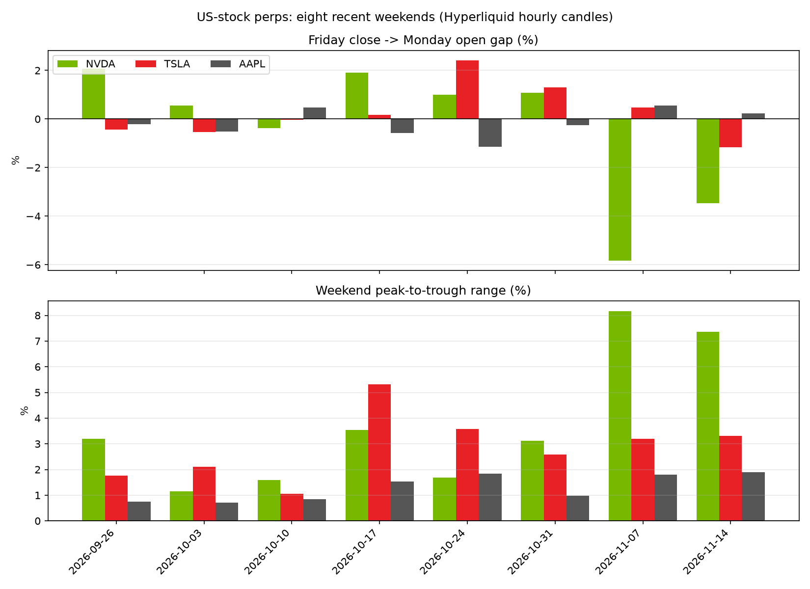

# Weekend Gap Risk — open research

**Read this first (one page, plain English).** This is independent, public research about a *class* of product: 24/7 perpetual futures whose underlying price comes from a stock market that closes on Friday and reopens on Monday. It is **not an audit**, and it makes no claim about any specific company or product.

## Three numbers

| Number | What it is | Value |
|---|---|---|
| **0.56%** | Median absolute Friday-close → Monday-open change across the 24 asset-weekends we measured | typical weekend gap |
| **−5.82%** | Largest gap: NVDA, weekend of 6–9 Nov 2026 ($186.69 → $175.82) | worst observed gap |
| **8.16%** | Largest high-to-low swing inside one weekend: NVDA, same weekend | worst observed intraday range |



*Funding was mostly small but not always positive: over these weekends the mean cumulative funding was +0.029% for NVDA, +0.045% for TSLA and +0.026% for AAPL. NVDA's funding flipped sign between weekends; TSLA and AAPL did not. See [`charts/weekend_funding.png`](charts/weekend_funding.png).*

## What this means for a trader at 50x

At 50x, margin is about **2%** of notional. A 2% adverse move consumes the whole margin. The measured median gap (0.56%) is already about a quarter of that margin; the worst gap (5.82%) is roughly **3x the entire margin**. A trader who is correctly margined on Friday can therefore be fully wiped out before they get a chance to react on Monday morning — the price move happens while the cash market is shut and the venue is still open.

The practical implication for anyone building or using such a venue is not "never trade weekends". It is that **the quote used for pricing, minting, redeeming and liquidating must know when the underlying market is closed, how old its price is, and how uncertain that price is**. The Solidity vault and tests in this repo demonstrate those guards in isolation.

## Method

1. **Market discovery.** We called the public Hyperliquid info endpoint (`perpDexs`) and selected the largest-open-interest-perp candidate for each of NVDA, TSLA and AAPL. Those resolved to the HIP-3 markets `xyz:NVDA`, `xyz:TSLA` and `xyz:AAPL` (see `data/perp_universe.csv`). No key or account is needed for reads.
2. **Window.** The last **8 completed** weekends before 23 Nov 2026: Saturdays 26 Sep, 3 Oct, 10 Oct, 17 Oct, 24 Oct, 31 Oct, 7 Nov and 14 Nov. "Completed" means the Monday morning candle exists; the weekend of 21–22 Nov was still in progress at fetch time and is excluded.
3. **Prices.** Hourly `candleSnapshot` rows (`1h`) were pulled per market per weekend. "Friday close" is the **close of the hourly candle starting 15:00 America/New_York** (the last full cash-session hour); "Monday open" is the **open of the hourly candle starting 09:00 America/New_York** (the hour containing the 09:30 cash open). US DST is applied with `zoneinfo`, so the UTC anchor moves from 19:00 to 20:00 after the November DST change.
4. **Weekend range.** Maximum candle high divided by minimum candle low, across candles from the Friday anchor through the candle before the Monday anchor, minus one.
5. **Funding.** Hourly `fundingHistory` rows were pulled for the same window; we report count, mean rate per print, and the sum of rates over the weekend. The sum is a simple sum of hourly rates, not a compounded return.
6. **Scope of the price proxy.** These are *perp* candles, not official Nasdaq prints. The Friday/Monday anchors are deliberate hourly proxies for cash-market close/open, not exchange settlement prices.

## Per-asset results

| Asset | Market | Median abs. gap | Worst gap | Mean weekend range | Mean cumulative funding |
|---|---|---:|---:|---:|---:|
| NVDA | `xyz:NVDA` | 1.50% | −5.82% (7 Nov weekend) | 3.72% | +0.0292% |
| TSLA | `xyz:TSLA` | 0.51% | +2.42% (24 Oct weekend) | 2.86% | +0.0445% |
| AAPL | `xyz:AAPL` | 0.50% | −1.15% (24 Oct weekend) | 1.30% | +0.0263% |

Full per-weekend numbers are in `data/weekend_summary.csv`; raw rows are in `data/<ASSET>_candles_hourly.csv` and `data/<ASSET>_funding_hourly.csv`. Headline numbers are also in `data/metrics.json`.

## Reproduce

```bash
pip install -r requirements.txt
python3 scripts/fetch_gaps.py

forge build
forge test
```

`fetch_gaps.py` accepts `--weekends N`, `--data-dir`, `--chart-dir` and `--today YYYY-MM-DD`. The endpoint in the script is a public, read-only HTTPS info endpoint; it is not a chain RPC endpoint. **No API key, RPC URL or secret is stored in any file in this repository.**

## Contracts and tests

- `src/StockTokenVault.sol` — minimal USDC mint/redeem vault priced by a mock equity oracle. It reads the asset's decimals (mock USDC = 6, shares = 18): 1 share at $100 redeems for exactly `100e6` base units. Guards: DST-aware US Eastern market hours (EST 14:30–21:00 UTC, EDT 13:30–20:00 UTC), maximum quote age, maximum confidence interval, and a pending-update blocker. Zero-share operations, future-dated quotes and zero prices are rejected; publishing a quote clears the pending flag so the vault cannot be frozen forever. Every guard can be disabled per deployment so a test can show the same attack with and without it.
- `test/` — five attack PoCs, each with a "without guard" and "with guard" case, plus decimal, guard-edge, DST and fuzz tests (`forge test`: **27 tests, all passing**).

| Test file | Attack / property demonstrated |
|---|---|
| `test/StaleFridayClose.t.sol` | Weekend mint against Friday's frozen quote after news moves the true price |
| `test/WideConfidenceInterval.t.sol` | Trading a midpoint whose stated confidence is too wide |
| `test/OracleFrontrunning.t.sol` | Getting ahead of a queued oracle update |
| `test/GuardHaltsRedemption.t.sol` | Unsafe weekend exit vs. halted redemption and safe reopen; schedule fuzz checked against an independently generated table |
| `test/MondayReopenGapLiquidation.t.sol` | 50x position liquidated on a pre-open quote vs. at the Monday reopen |
| `test/MarketHours.t.sol` | Winter/summer weekday boundaries, the 20:30 UTC DST regression, weekend closure and DST transition dates |
| `test/DecimalsAndGuards.t.sol` | 6-decimal USDC, exact 100 USDC redeem for 1 share, zero-share and future-timestamp rejections |

**Which guard stops what.** The stale-Friday-close and Monday-reopen-gap attacks are stopped in practice by the **market-hours check** — the weekend/pre-open quote never becomes executable. Staleness is a separate guard with its own fuzz test (`testStalePriceGuardFuzz`); the wide-CI and pending-update attacks are stopped by their matching guards.

`THREAT_MODEL.md` extends this to the 24/7 equity-perp asset class. `test/TestBase.sol` is a tiny local harness for the cheatcodes and assertions we use, so the project builds with no external Solidity dependencies and no RPC configuration.

## Known limits

- The mock oracle is **permissionless on purpose**, so anyone can publish a fresh, tight quote; the vault checks quote metadata (age, confidence, hours, pending) but cannot judge whether the price itself is correct.
- There is **no reentrancy guard**; this educational mock has no external callbacks, but a production vault would need one and a single consistent price read per transaction.
- There is **no exchange holiday calendar and no early-close handling** (e.g. 13:00 ET). The market-hours guard implements only the regular Mon–Fri session and the US DST rule.
- Hyperliquid **perp candles are a proxy** for official exchange prices; they are not Nasdaq/NYSE settlement prints, and hourly granularity cannot isolate the exact 16:00 ET close or 09:30 ET open.

## What we did not verify

- Official Nasdaq/NYSE closing and opening prices — the API only exposes perp candles.
- The user-supplied context that Nasdaq fell about 5% this week.
- Any real product's internal oracle, margin engine, funding implementation or market-hour policy.
- Historical depth beyond Hyperliquid's published 5,000-candle / 500-element response limits.

This is open research intended to start a conversation about risk controls, not to assign a finding to anyone.
